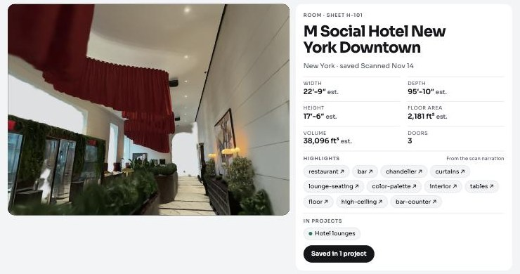

# 3DPinterest

Video captures of real spaces, reconstructed as navigable 3D scenes.

**Live demo:** https://danielesco1.github.io/3DPinterest/roomboard/

Roomboard is a Pinterest for rooms: browse real places by photo, keyword and size, open a scanned room in 3D, and click a highlight from the narration (for example "curtains" or "window-view") to see the room from where the narrator was standing when they said it.



## Try it in 30 seconds

1. Open the [live demo](https://danielesco1.github.io/3DPinterest/roomboard/).
2. Click **M Social Hotel New York Downtown** (or **McNally Jackson Books Seaport**).
3. Wait a few seconds for the 3D scan (about 32 MB), then drag to look around.
4. Click a highlight such as **curtains** or **high-ceiling** to fly to the narrator's view.

## How it works

Narrated phone video → **World Labs Atlas** (camera poses, depth, Gaussian splat) → **Astra stage** (room shell, openings, CAD drawings) → **ElevenLabs Scribe** (timestamped transcript, translated if needed) → highlights pinned to the narrator's camera at the moment each word was spoken → room data and scenes in **Google Cloud Storage** → **Roomboard** on GitHub Pages, rendered with **Spark** and **three.js**.

## Technology

| Technology | What it does here |
| --- | --- |
| [World Labs Atlas](https://www.worldlabs.ai) | Turns phone-video frames into camera positions, depth and a 3D Gaussian splat |
| Astra stage (agent-based, in `experiments/`) | Estimates the room shell, openings and CAD drawings from Atlas geometry, with human review |
| [Spark](https://sparkjs.dev) (World Labs) + [three.js](https://threejs.org) | Renders 2-million-splat rooms in the browser, trims them to the room, keeps the camera inside, and flies to each highlight |
| [ElevenLabs Scribe](https://elevenlabs.io/speech-to-text) | Transcribes the narration with word-level timestamps, including a Japanese walkthrough |
| [Claude](https://claude.ai) (Anthropic) | Translated the Japanese narration, extracted the highlight tags, and helped build the pipeline and app |
| [Whisper](https://github.com/openai/whisper) (optional) | Local, offline transcription in the pipeline |
| [Google Cloud Storage](https://cloud.google.com/storage) | Public hosting for 3D scans, room data and photos |
| Google Drive | The team's source of truth for captures and CAD |
| [GitHub Pages](https://pages.github.com) | Hosts the site: plain HTML, CSS and JavaScript, no server, no build step |
| ffmpeg, Pillow | Audio extraction and photo resizing |

## Layout

- `roomboard/`: static gallery and room pages.
- `3d-viewer/`: shared Spark viewer and static scene exporter.
- `experiments/atlas-video-to-3d/`: Atlas reconstruction, Astra geometry, drawings and per-space publishing pipeline. See its [standard workflow](experiments/atlas-video-to-3d/STANDARD_WORKFLOW.md).

## Tests

```sh
cd experiments/atlas-video-to-3d
python3 -m unittest discover -p "test_*.py"
```

## Private assets

Keep API keys in ignored `.env` files and scene assets in ignored `work/` folders. Assets are published separately to Drive or the configured storage bucket, never to Git. Geometry and dimensions are uncalibrated estimates requiring review.

## Use it with your own rooms

1. **Capture and reconstruct.** Follow the [standard workflow](experiments/atlas-video-to-3d/STANDARD_WORKFLOW.md) to turn a narrated phone video into a splat, camera poses and a room shell.
2. **Export a viewer scene.** `python3 3d-viewer/export_static.py` writes a static folder per scene (see [3d-viewer/README.md](3d-viewer/README.md)). Host it anywhere that serves static files over HTTPS.
3. **Describe the room** in a folder next to an `index.json`:
   - `index.json`: `{"format_version": 1, "rooms": [{"id", "name", "place", "folder", "calibrated"}]}`
   - `<folder>/space.json`: name, place, `w`/`d`/`h`, `doors` (`wall` N/E/S/W, `pos` 0 to 1, `w`), `keywords`, optional `thumb` (photo URL) and `viewer` (your exported scene's `index.html`). `backend/export_rooms.py` builds this from a scan's size and tags.
   - `<folder>/tags.json`: anchors with `tags`, the narration `speech` that produced them, and a 3D `position` (plus optional `camera`) in the splat's coordinates.
4. **Point Roomboard at it.** Fork the repo, set `window.ROOMBOARD_DATA_URL` in `roomboard/index.html` to your folder's HTTPS address, and enable GitHub Pages. Your host must allow cross-origin GET requests from your site.

Sizes from scans are uncalibrated and shown as "est." until a real site measurement is added.

## Known limitations

- Scale is uncalibrated: scans are in scene units read as metres and shown as "est." until a site measurement is added.
- Highlight positions are estimates taken from the narrator's camera, not measured object locations.
- Gaussian splats look sharpest from where the video was filmed; the viewer keeps you near those views.
- The bookstore (L-shaped) is not trimmed yet; the trim only supports convex rooms today.

## License

[MIT](LICENSE)
